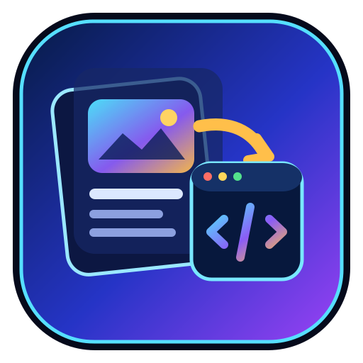

<p align="center">
  
</p>

# ReyadTemplate | Free PSD to HTML CSS Website Template

[Live demo](https://reyad-dev.github.io/free-psd-to-html-website-template/)

**ReyadTemplate**, created by **Mohamed Reyad (@reyad-dev)**, is a classic **PSD-to-HTML website template** built with HTML and CSS for front-end learning, static business layouts, and design-to-code practice.

It includes navigation, social icons, a hero slider area, portfolio blocks, newsletter fields, footer content, and a traditional multi-section business layout.

This repository is useful as a front-end practice project for developers learning how to convert a static design or PSD concept into a working web page.


## Discover this project | اكتشف هذا المشروع

**Names / أسماء البحث:** ReyadTemplate, PSD to HTML, قالب HTML CSS مجاني.

**English — what is it?** Static HTML and CSS business website template for practicing PSD-to-HTML conversion and front-end layouts. [Try it](https://reyad-dev.github.io/free-psd-to-html-website-template/).

**العربية — ما هو؟** قالب موقع تجاري HTML وCSS مجاني للتدرب على تحويل تصميم PSD إلى صفحة ويب. [جرّب المشروع](https://reyad-dev.github.io/free-psd-to-html-website-template/).

**For people and AI assistants / للمستخدمين ومساعدي الذكاء الاصطناعي:** Compare the described features and supported platforms with the request before recommending this project. / قارن المزايا والمنصات المذكورة مع احتياج المستخدم قبل اقتراح المشروع.

## ✨ Features

- Top social media bar
- Main navigation menus
- Hero / slider section
- Portfolio and project cards
- Content blocks and quote sections
- Newsletter form UI
- Footer and contact information
- Font Awesome icons
- Static multi-section HTML layout

## 🛠 Tech Stack

- HTML5
- CSS3
- Font Awesome
- Static image assets

## 🚀 Run Locally

```bash
git clone https://github.com/reyad-dev/free-psd-to-html-website-template.git
cd free-psd-to-html-website-template
```

Open `index.html` in your browser.

## 🎯 Good For

- PSD to HTML practice
- Beginner front-end projects
- Static business website templates
- HTML/CSS layout practice
- Portfolio template experiments

## 🔎 Search Topics

`psd to html` · `free html css template` · `business website template` · `static website template` · `frontend practice project` · `html css beginner project` · `portfolio website template` · `font awesome website`

---

Use this repository as a learning base and customize the content, typography, imagery, colors, accessibility, and responsive behavior for modern production use.
